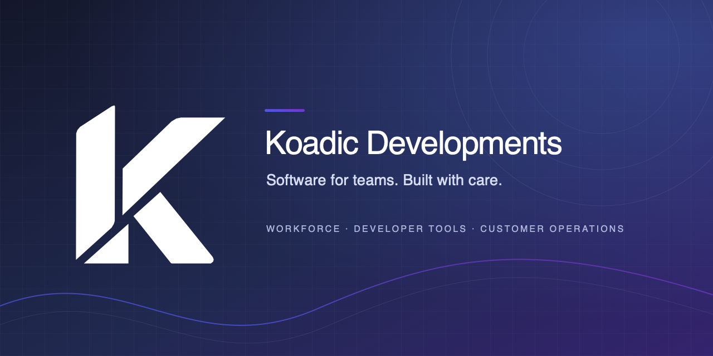

# Koadic Developments

**We build software that helps teams do their work with clarity and confidence.**

This repository contains the public organization profile, community guidance, and engineering standards for Koadic Developments. It is a profile and standards repository, not a product source repository. Most Koadic product source code is private.

## Engineering standards

- Work starts from a clear user or operational problem.
- Pull requests stay focused and include evidence of relevant checks.
- Security, privacy, accessibility, and data handling are considered according to risk.
- A merge is separate from a production release. Releases need appropriate verification and a recovery path.
- Automated checks should provide useful signal without duplicating service monitoring.

See [CONTRIBUTING.md](CONTRIBUTING.md), [README_STANDARD.md](README_STANDARD.md), and [README_TEMPLATE.md](README_TEMPLATE.md).

## Community and security

- [Report a security concern](SECURITY.md). Please use the private reporting route in that policy.
- Use the issue forms for feedback about this public profile and repository.
- For product support, use the contact route on [koadic.dk](https://koadic.dk).

## Repository contents

| Path | Purpose |
| --- | --- |
| `profile/README.md` | Organization profile shown on GitHub |
| `profile/assets/` | Profile banner and brand assets |
| `CONTRIBUTING.md` | Contribution and release guidance |
| `SECURITY.md` | Vulnerability reporting policy |
| `README_STANDARD.md` | Guidance for accurate product READMEs |
| `README_TEMPLATE.md` | Copyable project README outline |
| `.github/ISSUE_TEMPLATE/` | Feedback forms |
| `.github/PULL_REQUEST_TEMPLATE.md` | Pull request checklist |
| `.github/workflows/` | Repository automation and shared checks |

Koadic materials are published here for visibility and reference. Unless a file is accompanied by an explicit license, this repository does not grant permission to reuse its contents.

## Contact

- Website: [koadic.dk](https://koadic.dk)
- Development: [development@koadic.dk](mailto:development@koadic.dk)
