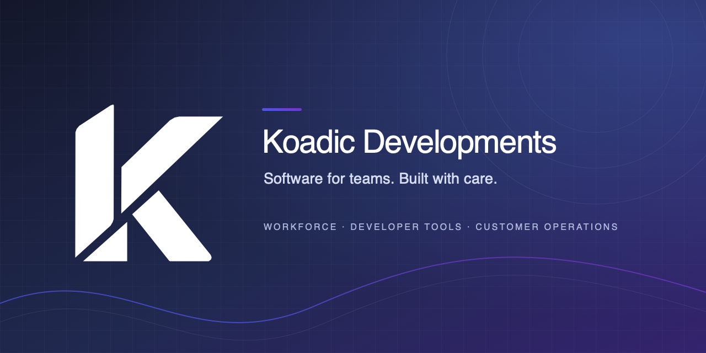

  

# Koadic Developments

**Software for teams. Built with care.**

We design, build, and operate digital tools for the everyday work behind a modern organization.

## What we work on

| Area | Focus |
| --- | --- |
| **Workforce** | Scheduling, time registration, HR workflows, and employee tools |
| **Developer tools** | Issue tracking, project workflows, and software delivery |
| **Customer operations** | CRM, support, customer portals, and invoicing workflows |
| **Platform services** | Authentication, APIs, security controls, and shared infrastructure |
| **Mobile** | iOS tools for employee and customer workflows |

Most Koadic product repositories are private. This profile describes our work; it does not imply that a product or source repository is publicly available.

## How we build

- Start with a specific user or operational need.
- Keep changes focused, reviewed, and supported by relevant checks.
- Treat privacy, security, and reliable recovery as part of the design.
- Verify releases in the environment they are intended to reach.

## Get in touch

- [koadic.dk](https://koadic.dk)
- [Development team](mailto:development@koadic.dk)
- [Security reporting policy](../SECURITY.md)
